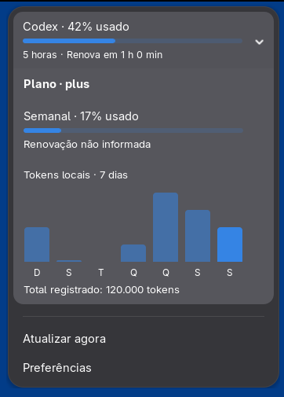

# AI Usage

Extensão para GNOME Shell que exibe cotas de assinatura e consumo diário de
tokens locais do Codex, Claude Code e Antigravity.

**Compatibilidade:** GNOME Shell 50 e 51 · **Versão:** 0.2.0

<p align="center">
  
</p>

<p align="center"><sub>Extensão em execução no GNOME Shell 51.</sub></p>

## Funcionalidades

- Indicador no painel e menu com uso da assinatura, janelas de cota e renovação.
- Histórico de sete dias, com tokens por dia no tooltip e total abaixo do gráfico.
- Widgets nativos e cores do tema GNOME.
- Providers opcionais, habilitados individualmente, com autenticação local existente.

## Instalação

Requer **GNOME Shell 50 ou 51** e os CLIs dos providers habilitados,
previamente autenticados. A geração do pacote requer Node.js, gettext,
`glib-compile-schemas` e `gnome-extensions`.
O histórico local do Antigravity requer também o comando `sqlite3`; as cotas
funcionam sem essa dependência. Não é necessário Python.

```bash
git clone https://github.com/Ryannnkl/gnome-ai-usage.git
cd gnome-ai-usage
npm run pack
gnome-extensions install --force dist/ai-usage@ryannnkl.com.shell-extension.zip
```

Após a instalação, encerre e inicie novamente a sessão do GNOME. Em seguida:

```bash
gnome-extensions enable ai-usage@ryannnkl.com
```

O menu é aberto pelo indicador no painel. A seleção de providers fica em **Preferências**.

[Migração do UUID anterior](docs/DEVELOPMENT.md#migrar-da-identidade-antiga).

## Escopo e privacidade

A extensão reutiliza credenciais locais em modo somente leitura, não as renova
e não coleta telemetria. O histórico contabiliza **tokens dos registros locais**,
não o consumo completo da conta em outros dispositivos. Dias sem registros
não são apresentados como consumo zero.

---

[Reportar um problema](https://github.com/Ryannnkl/gnome-ai-usage/issues) ·
[Guia técnico](docs/DEVELOPMENT.md) · [Changelog](CHANGELOG.md) · [Licença GPL-2.0-or-later](LICENSE) ·
[ryannnkl.com](https://ryannnkl.com)
