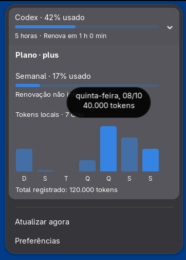

<div align="center">

# AI Usage

### Suas cotas de IA. Direto no painel do GNOME.

Codex · Claude Code · Antigravity

**GNOME Shell 51** · **v0.2.0** · Sem telemetria

</div>

<table>
  <tr>
    <th>Cotas e histórico em um só lugar</th>
    <th>Os tokens de cada dia, ao passar o mouse</th>
  </tr>
  <tr>
    <td></td>
    <td></td>
  </tr>
</table>

<p align="center"><sub>Interface real no Shell DevKit, com dados de demonstração.</sub></p>

## Menos abas. Mais clareza.

| | |
| --- | --- |
| **Cotas à vista** | Uso da assinatura e tempo até a renovação, sem abrir outro app. |
| **Sete dias de tokens** | Barras diárias, detalhes no hover e um único total. |
| **Seu GNOME, seu tema** | Menu nativo e cores de destaque do sistema. |
| **Só o que você usa** | Ative cada provider separadamente e reutilize o login local. |

## Instalar

Requer **GNOME Shell 51** e **Python 3**. Faça login nos CLIs dos providers que quiser usar.
Para gerar o pacote, tenha Node.js, gettext, `glib-compile-schemas` e `gnome-extensions` instalados.

```bash
git clone https://github.com/Ryannnkl/gnome-ai-usage.git
cd gnome-ai-usage
npm run pack
gnome-extensions install --force dist/ai-usage@ryannnkl.com.shell-extension.zip
```

Saia e entre novamente na sessão. Depois, habilite:

```bash
gnome-extensions enable ai-usage@ryannnkl.com
```

Clique no indicador do painel para ver as cotas. Em **Preferências**, escolha seus providers.

[Já usava a versão com o domínio antigo? Veja como migrar.](docs/DEVELOPMENT.md#migrar-da-identidade-antiga)

## Local por escolha

Sem colar chaves de API, sem renovar suas credenciais e sem telemetria.
O gráfico contabiliza **tokens registrados neste computador**, não o consumo completo
da conta em outros dispositivos. Dias sem registros não viram consumo zero.

---

[Reportar um problema](https://github.com/Ryannnkl/gnome-ai-usage/issues) ·
[Guia técnico](docs/DEVELOPMENT.md) · [Changelog](CHANGELOG.md) ·
[ryannnkl.com](https://ryannnkl.com)
